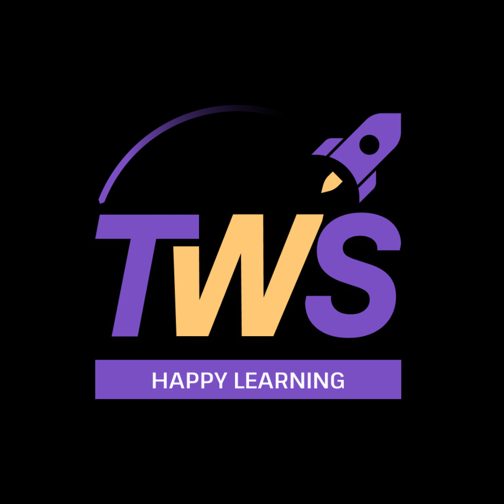
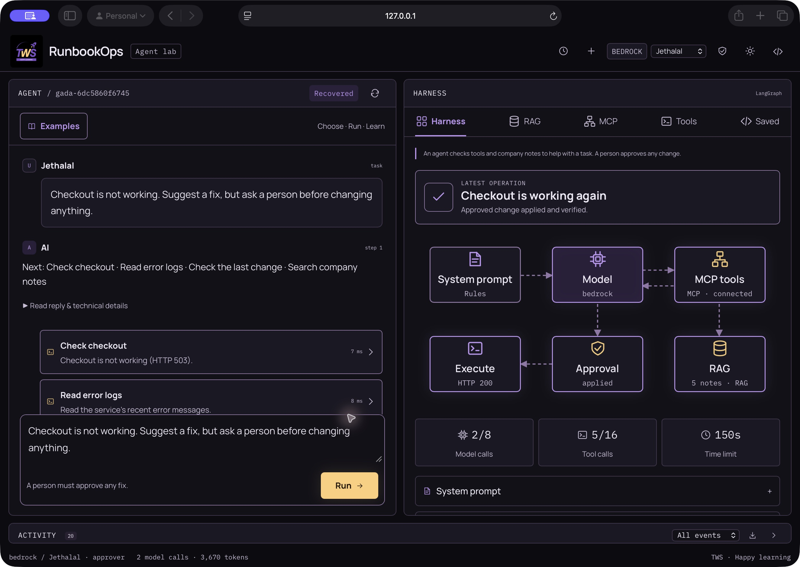
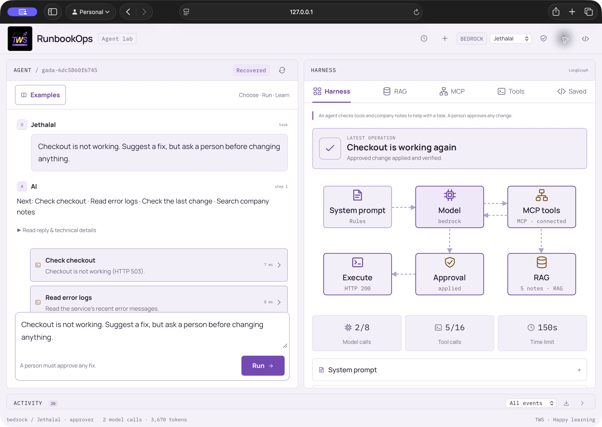
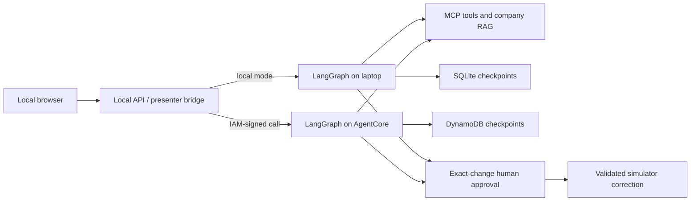

<p align="center">
  
</p>
<h1 align="center">RunbookOps</h1>
<p align="center">See what your DevOps agent reads, calls, and proposes. Approve the exact fix before it runs.</p>
<p align="center">
  <a href="https://github.com/TrainWithShubham/runbookops/actions/workflows/checks.yml"></a>
  <a href="LICENSE"></a>
  <a href="pyproject.toml"></a>
  <a href="docs/TESTING.md"></a>
</p>

RunbookOps is a small agent workspace built with **LangGraph, MCP, and RAG**. An incident unfolds in the browser: health checks, logs, deployment evidence, cited runbooks, a proposed change, and a person deciding whether it should run.

The included Gada Electronics checkout is broken. Bagha can investigate. Jethalal can approve. The agent can prepare a correction, but the application controls authorization and execution. The operational target is a simulator; the optional CloudWatch connector reads a dedicated AWS sample log group.

<!-- The screenshots below are captured from the running application, not mockups. -->


<details>
<summary>View the light theme</summary>



</details>

## Index

[Quick start](#quick-start) · [What you can inspect](#what-you-can-inspect) · [Live models](#live-models) · [Docker](#docker) · [AWS presenter mode](#aws-presenter-mode) · [Architecture](#architecture) · [Development](#development) · [Deployment and releases](#deployment-and-releases) · [Documentation](#documentation) · [Contributing](#contributing) · [License](#license)

## Quick start

Install [uv](https://docs.astral.sh/uv/getting-started/installation/), then:

```bash
git clone https://github.com/TrainWithShubham/runbookops.git
cd runbookops
uv sync --frozen
uv run runbookops demo
uv run runbookops --mode offline serve --demo-auth --port 8002
```

Open **http://127.0.0.1:8002/**. Offline practice needs no API key, AWS account, Docker, or Node.js. uv installs the selected Python version and locked dependencies.

Try this:

> Checkout is not working. Read the logs and runbook, then prepare a fix for a person to approve.

Watch the tools and retrieved evidence. Inspect the proposed URL change. Switch to the approver to review it, then verify checkout returns HTTP 200. The [beginner walkthrough](docs/BEGINNER_DEMO.md) explains each step. Offline mode uses fixed responses to teach the flow; select a live provider to let a model choose the tool calls.

## What you can inspect

| Component | Visible evidence |
|---|---|
| System prompt | Instructions, boundaries, and version |
| Model | Provider, tool requests, call/token limits, reported usage |
| RAG | Mixed-format documents, chunks, source locations, role filtering, cache hits |
| MCP | Discovered tools, schemas, arguments, results, transport |
| LangGraph | Investigation, saved review checkpoint, execution, recovery |
| Approval | Caller role, exact proposal, hash, expiry, decision |
| Operations | Event timeline, health verification, saved work, trace export |

Documents include **PDF, DOCX, PPTX, Markdown, and text**. All supplied knowledge is synthetic. The UI includes dark/light themes, four short starter prompts, and six further examples. See [the harness walkthrough](docs/HARNESS_DEMOS.md).

## Live models

Copy `.env.example` to `.env`, add your own OpenRouter key, and keep `RUNBOOKOPS_FREE_ONLY=true`:

```bash
cp .env.example .env
uv run runbookops models
uv run runbookops --embedding semantic index
uv run runbookops --mode openrouter --embedding semantic serve --demo-auth --port 8002
```

Semantic retrieval downloads a small local embedding model once. Free model availability and quotas depend on the provider. A failure never silently selects paid inference. A ChatGPT or Claude subscription does not supply the API access used by this app.

[Bedrock setup](docs/BEDROCK_DEMO.md) covers running the agent locally with AWS inference. **That mode bills model usage to your AWS account.** AgentCore presenter mode below also runs the agent itself in AWS.

## Docker

```bash
docker compose up --build -d --wait
```

Open **http://127.0.0.1:8006/**. The offline container runs as a non-root user, with a read-only root filesystem and persistent state volume.

Docker network forwarding does not satisfy the local persona login's loopback check. Connect through the UI using a short-lived demo token:

```bash
docker compose exec app runbookops --as bagha token
```

Paste it into the connection dialog. Generate a Jethalal token with `--as jethalal` when reviewing a proposal. Keep tokens out of recordings and shared logs. For the convenient persona picker, use the uv quick start.

```bash
docker compose logs -f app
docker compose down
```

Stopping preserves saved work. `docker compose down --volumes` deletes that local demo state. See [container operations](docs/CONTAINERS.md).

## AWS presenter mode

Keep the browser and small API bridge on your laptop; run the agent on **Amazon Bedrock AgentCore Runtime**. AWS IAM signs the cloud requests. Model credentials and the demo signing key stay out of the browser.

After following the [Terraform deployment guide](docs/AWS.md):

```bash
uv sync --frozen --extra aws
uv run runbookops present --runtime-arn YOUR_RUNTIME_ARN
```

Open **http://127.0.0.1:8005/**. The same UI now inspects the cloud agent's tools, RAG, events, and DynamoDB checkpoints. The presenter bridge is restricted to localhost. It is intended for screen sharing by the operator; attendees run their own local copy.

The demo deployment uses `us-west-2`, IAM admission, a digest-pinned ARM64 image, dedicated permissions, durable DynamoDB state, and a 60-second idle timeout. Default presenter admission permits one investigation at a time and 20 starts per UTC day. These controls do not impose an AWS billing cap. [Costs and shutdown](docs/COSTS.md) explain the $10/month hosting target and separate inference costs.

## Architecture



LangGraph owns the agent loop. AgentCore Runtime hosts it; managed AgentCore Harness is a separate orchestration option. The model has no apply tool. An authorized human decision lets the application execute the reviewed change, with revision and idempotency checks.

Read [architecture](docs/ARCHITECTURE.md) and [security boundaries](docs/SECURITY.md) before connecting real operational systems. The demo identities are not a production identity provider.

## Development

```bash
uv sync --frozen --extra aws
npm ci
make check
```

Node.js 26+ is needed for JavaScript tests, not for running the app. On systems without Make, use the individual commands in [testing](docs/TESTING.md).

Both application coverage gates require 100%, without source exclusions. Deterministic tests include real local RAG, HTTP/stdio MCP, SQLite restart/resume, API flows, mocked AWS adapters, and browser-module tests. Actual browser layout, Terraform lifecycle, and live model behavior have separate verification paths. Coverage is not a guarantee that a model will always produce the right result.

| Path | Purpose |
|---|---|
| `src/runbookops` | Agent, UI/API, providers, RAG, tools, permissions, storage, presenter bridge |
| `examples` | Small model, agent, RAG, and MCP examples |
| `resources` | Synthetic documents, incident fixture, editable sources |
| `tests` | Python integration and JavaScript UI tests |
| `infra/terraform` | State/CI bootstrap and presenter infrastructure |
| `deploy` | Image publishing, cloud smoke checks, compatibility tools |
| `.github/workflows` | Checks, security, deployment, releases |

## Deployment and releases

Pull requests run the application gates, offline evaluations, container smoke checks, Terraform tests, and security checks. Cloud deployment is explicitly triggered from the trusted main branch and uses GitHub OIDC rather than stored AWS access keys. Images are pinned by digest; deployment records and the previous digest support rollback.

The [AWS guide](docs/AWS.md) covers bootstrap, deployment, CI configuration, updates, rollback, and cleanup. [Release notes](CHANGELOG.md) distinguish available behavior from the [roadmap](docs/ROADMAP.md).

## Documentation

- [Run guide](RUNBOOK.md): setup, CLI, providers, API, and shutdown.
- [Beginner demo](docs/BEGINNER_DEMO.md): short prompts and visible operations.
- [Harness examples](docs/HARNESS_DEMOS.md): RAG, MCP, approval, routing, and evaluations.
- [HTTP API](docs/API.md): authenticated application endpoints.
- [AWS deployment](docs/AWS.md), [containers](docs/CONTAINERS.md), [costs](docs/COSTS.md), and [IAM](docs/IAM.md).
- [Testing](docs/TESTING.md), [verification](docs/VERIFICATION.md), and [troubleshooting](docs/TROUBLESHOOTING.md).

## Contributing

Small, well-tested improvements are welcome. Read [CONTRIBUTING.md](CONTRIBUTING.md), open an issue describing the problem, and keep changes focused. Report vulnerabilities through [SECURITY.md](SECURITY.md).

RunbookOps started in the [Agentic AI for DevOps course](https://github.com/TrainWithShubham/agentic-ai-for-devops/tree/v2); [module 6](https://github.com/TrainWithShubham/agentic-ai-for-devops/tree/v2/module-6) now links here. Application development and releases live in this repository. The Gada Electronics scenario is fictional and has no affiliation with the television programme.

## License

[Apache-2.0](LICENSE). Bundled fonts retain their own license notices. TWS branding identifies this project and its origin.
